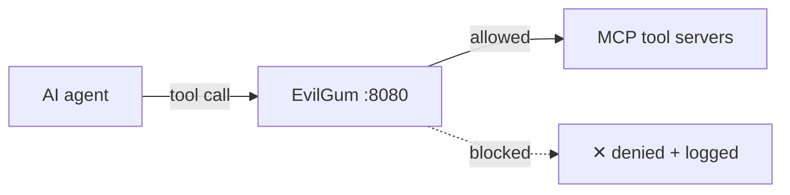

> Phase 1 update (2026-09-21): supported single-worker durability/recovery checks pass. Core: 166 passed, 1 expected failure; enterprise: 20 passed. Read [Phase 1 operations](PHASE1-OPERATIONS.md) for required storage, recovery-epoch JWT claims and deployment limits. Public packaged release remains Phase 2.

<div align="center">

# EvilGum — Security Gateway for MCP

**An experimental security gateway for MCP tool traffic.**
It checks identity, tool permissions, schema pins, and configured data-flow policies. Public beta readiness is still being verified; see [BETA-READINESS.md](BETA-READINESS.md) for supported scope and release gates.


</div>

---

## The problem

MCP lets an AI agent use real tools — read files, send email, query databases, run commands. Applications still need to choose and enforce tool permissions and data-handling policies. A single poisoned tool description or a hijacked agent can read a secret and exfiltrate it, or run a destructive command.

## What EvilGum does

The /mcp endpoint has been tested with the official Python SDK 1.26.0 using MCP 2025-11-25 stateless JSON HTTP. See [MCP-COMPATIBILITY.md](MCP-COMPATIBILITY.md) for the exact scope and smoke client.



Every tool call passes through the gateway first, which checks: *is this identity real? is this agent allowed this tool? is a tainted session trying to exfiltrate? is this an injection or a rug-pull?* — then forwards it or blocks it.

## Controls

| Control | What it does |
|---|---|
| **Identity** | Asymmetric JWT (RS256/ES256), enforced `exp`/`aud`/`iss`; refuses to start on weak config |
| **Authorization** | Per-tool RBAC, scope-based admin, cryptographic capability tokens (macaroons) that only attenuate |
| **Information-flow control** | Capability taint blocks read-then-exfiltrate chains; optional value-level tracking of source data into sinks |
| **Rug-pull prevention** | Calls require a verified pin; detected metadata drift quarantines the tool on subsequent listing |
| **DLP & WAF** | PII redaction on tool responses; injection / SSRF / traversal / log4j signatures with a recursive decoder |
| **Transport & resilience** | Verified mTLS, secrets from env/KMS, **fail-closed** on backend outage |
| **Observability** | Hash-chained **tamper-evident audit log**, Prometheus metrics, real-time exfil/rug-pull alerts |

## Verification

Local regression run on 2026-09-21: **166 passed, 1 expected failure**. This is test evidence, not external validation or proof of complete attack prevention. The expected failure concerns re-encoded data bypassing value tracking.

Historical benchmark scripts remain in the repository, but their numerical claims were not re-certified for this change.

```bash
python -m pip install -e ".[dev,integration]"
python -m pytest -q
```

## Quickstart

Use the versioned developer-beta assets and [release instructions](RELEASE.md). The [disposable quickstart](release/QUICKSTART.md) runs allow/deny/audit and recovery checks with synthetic credentials. Public candidate availability and evidence are recorded in the release; a source checkout alone is not installation validation.

```sh
# After installing the released wheel and hash-locked runtime dependencies:
evilgum --version
evilgum init-config --directory ./deployment
```

For an actual deployment, follow [PHASE1-OPERATIONS.md](PHASE1-OPERATIONS.md). Production uses /mcp; /rpc is disabled. Configure trusted JWT eg_epoch claims, review tenant grants and pins, then complete tools/list before calls. The one-worker deployment uses durable local SQLite storage.

## Open-core

EvilGum's engine is free and open (Apache-2.0). Commercial deployment and management features are planned; availability is not established by this repository — [get in touch](https://faseel.app/evilgum) or email [info@faseel.app](mailto:info@faseel.app).

## Status

Developer-beta release candidate. Local security and container persistence/recovery checks pass. See RELEASE.md for packaging evidence and remaining outside-tester acceptance; broader client compatibility and enterprise pilot validation remain open. See [`SECURITY.md`](SECURITY.md).

## License

[Apache-2.0](LICENSE) © Faseel
